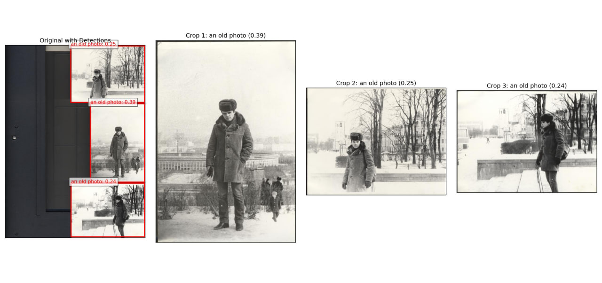
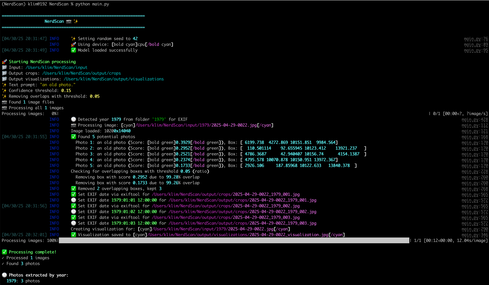

# NerdScan 📷 ✨

> [!IMPORTANT]
> **NerdScan is no longer actively maintained.**
>
> This repository was my initial open-source approach to extracting photos from scanned album pages. Since then, I trained a custom model specifically for this problem and turned that work into **[ScanCropper](https://scancropper.com)**, the production version I actively maintain.
>
> If you want the best results and the easiest workflow, I recommend using **[ScanCropper](https://scancropper.com)** instead.
>
> I’m leaving NerdScan up as a reference for the original idea and implementation, but I’m not planning new features, ongoing support, or regular updates here.

<div align="center">




[](https://opensource.org/licenses/MIT)
[](https://www.python.org/downloads/)

**Revive your old photos from scanned documents using AI-powered detection and extraction**

[Key Features](#key-features) | [Installation](#installation) | [Usage](#usage) | [Examples](#examples) | [How It Works](#how-it-works) | [Configuration](#configuration)

</div>

---

## Motivation

Nothing out of the box worked well for extracting individual photos from album scans, so I built NerdScan as an initial open-source prototype. That work later evolved into ScanCropper, where I trained a custom model specifically for this problem and focused ongoing development there.

## Key Features

- 🔍 **AI-Powered Detection**: Uses state-of-the-art AI object detection to find photos in scans
- 🖼️ **Smart Photo Extraction**: Precisely crops and saves individual photos from cluttered scans
- 📊 **Visual Feedback**: Creates clear visualizations of detection results for easy verification
- 📅 **Intelligent Dating**: Automatically adds EXIF metadata based on folder structure with sequential dates
- 🌲 **Flexible Organization**: Option to preserve original folder structure or use flat output
- 🔄 **Smart Filtering**: Removes overlapping or low-confidence detections for clean results
- 🚀 **User-Friendly CLI**: Beautiful command-line interface with progress tracking and rich output
- 🛠️ **Highly Configurable**: Fine-tune every aspect of detection to suit your needs

## Why NerdScan?

If you have old photo albums, scrapbooks, or document collections with multiple photos per page, NerdScan makes digitizing them effortless. Instead of manually cropping each photo, simply scan entire pages and let NerdScan handle the rest - it finds, extracts, and even dates your photos automatically!

## How It Works

NerdScan uses the Grounding DINO object detection model from Hugging Face (`IDEA-Research/grounding-dino-base`) to find photos in your scanned images. It leverages natural language prompts like "an old photo" to identify photos with high accuracy. The detected photos are then precisely cropped, and can be automatically tagged with dates based on your folder structure.

### Detection Process

1. **AI-Powered Detection**: Uses the Grounded Object Detection model from Hugging Face
2. **Text Prompting**: Leverages natural language prompts to find photos in scanned images
3. **Confidence Filtering**: Removes low-confidence detections to reduce false positives
4. **Overlap Handling**: Identifies and filters overlapping detections to avoid duplicates

### Photo Extraction

1. **Smart Cropping**: Precisely extracts each detected photo as a separate image
2. **Metadata Enhancement**: Sets EXIF date data based on folder names (e.g., "1979")
3. **Quality Preservation**: Saves high-quality JPG files with original color profiles

### Year Detection

1. **Automatic Year Extraction**: Detects years from folder names (e.g., "1979")
2. **Smart Dating**: Creates sequential dates within the year for multiple photos
3. **Comprehensive Metadata**: Sets dates in multiple formats for maximum compatibility

## Installation

### Prerequisites

- Python 3.7+
- [Optional] CUDA-capable GPU for faster processing

### Quick Install

1. Clone this repository:
   ```bash
   git clone https://github.com/klimentij/NerdScan.git
   cd NerdScan
   ```

2. Create a virtual environment and install dependencies with [uv](https://github.com/astral-sh/uv):
   ```bash
   uv venv
   source .venv/bin/activate  # On Windows: .venv\Scripts\activate
   uv pip install -r requirements.txt
   ```

## Usage

### Getting Started

Put your scanned images (like JPGs) into the `input` directory. NerdScan supports images of any size and resolution - it's been tested with scans up to 1200 DPI, handling extremely large files without issues.

**Recommendation:** Organize them into subfolders named after the year the photos were taken (e.g., `input/1979/scan1.jpg`, `input/1980/scan2.jpg`). NerdScan will automatically detect the year from the folder name and use it to set the EXIF creation date for the extracted photos, assigning sequential dates within that year.

```bash
python main.py
```

This will:
1. Scan for images in the `input` directory
2. Extract detected photos to `output/crops`
3. Save visualizations to `output/visualizations`

### Beautiful CLI Interface

NerdScan features a rich command-line interface with detailed progress tracking and vibrant output:



### Command Line Options

```
python main.py --help
```

| Option | Description | Default |
|--------|-------------|---------|
| `-i, --input` | Input directory containing scanned images | "input" |
| `-o, --output` | Output directory for results | "output" |
| `--text-prompt` | Text prompt for AI detection | "a photo. a picture. a photograph." |
| `--single-image` | Process a single image instead of directory | None |
| `--preserve-structure` | Preserve folder structure in output | False |
| `--remove-overlaps` | Remove overlapping detection boxes | False |
| `--overlap-threshold` | Ratio threshold for considering boxes as overlapping (0.0 to 1.0). A higher value allows more overlap. | 0.05 |
| `--confidence-threshold` | Minimum confidence score to keep detections (0.0 to 1.0). Lower values find more potential photos but may increase false positives. Higher values are stricter. | 0.15 |
| `--seed` | Random seed for reproducibility | 42 |
| `--sample-size` | Number of random images to process | All |
| `--device` | Device to run model on ('cuda' or 'cpu') | Auto-detect |

## Examples

### Process a Single Image

```bash
python main.py --single-image path/to/scan.jpg
```

### Preserve Folder Structure

```bash
python main.py -i input -o output --preserve-structure
```

### Use a Custom Text Prompt

For older or vintage photos:
```bash
python main.py -i input -o output --text-prompt "an old photograph. a vintage photo."
```

For Polaroid photos:
```bash
python main.py -i input -o output --text-prompt "a polaroid photo. an instant camera picture."
```

### Adjust Confidence Threshold

More strict detection (fewer false positives):
```bash
python main.py -i input -o output --confidence-threshold 0.25
```

More lenient detection (fewer missed photos):
```bash
python main.py -i input -o output --confidence-threshold 0.10
```

### Adjust Overlap Threshold

Allow less overlap between detected boxes (removes more): 
```bash
python main.py -i input -o output --remove-overlaps --overlap-threshold 0.01
```

Allow more overlap between detected boxes (removes fewer):
```bash
python main.py -i input -o output --remove-overlaps --overlap-threshold 0.10
```

### Process a Subset of Images

```bash
python main.py -i input -o output --sample-size 10
```

## Output Structure

```
output/
  ├── crops/             # Extracted photos
  │   ├── file1_001.jpg
  │   ├── file1_002.jpg
  │   └── ...
  └── visualizations/    # Detection visualizations
      ├── file1_visualization.jpg
      └── ...
```

With `--preserve-structure` enabled, the subfolder structure from the input directory will be maintained.

## Best Practices

1. **Folder Organization**: Name folders with years when possible (e.g., "1979") for automatic EXIF dating
2. **Scan Quality**: Higher quality scans produce better detection results
3. **Custom Prompts**: Use specific text prompts to improve detection for challenging cases
4. **Confidence Tuning**: Adjust confidence threshold based on your specific scans and needs

## Troubleshooting

### Common Issues

- **No detections**: Try lowering the `--confidence-threshold` (e.g., `--confidence-threshold 0.10`). This makes the model more lenient.
- **Too many false positives**: Increase the `--confidence-threshold` (e.g., `--confidence-threshold 0.25`). This makes the model stricter.
- **Overlapping detections**: Ensure `--remove-overlaps` is enabled. If still too many overlaps remain, try lowering the `--overlap-threshold` (e.g., `--overlap-threshold 0.01`) to be more aggressive about removing overlapping boxes. If important overlapping boxes are being removed, try increasing the `--overlap-threshold` (e.g., `--overlap-threshold 0.10`).
- **Specific photo types not detected**: Customize the text prompt (e.g., for Polaroids: `--text-prompt "a polaroid photo."`) to better match the objects you are looking for.

## License

This project is licensed under the MIT License.

## Acknowledgements

- [Grounding DINO](https://github.com/IDEA-Research/GroundingDINO) - For the object detection model
- [HuggingFace Transformers](https://github.com/huggingface/transformers) - For model access
- [Rich](https://github.com/Textualize/rich) - For beautiful terminal output
